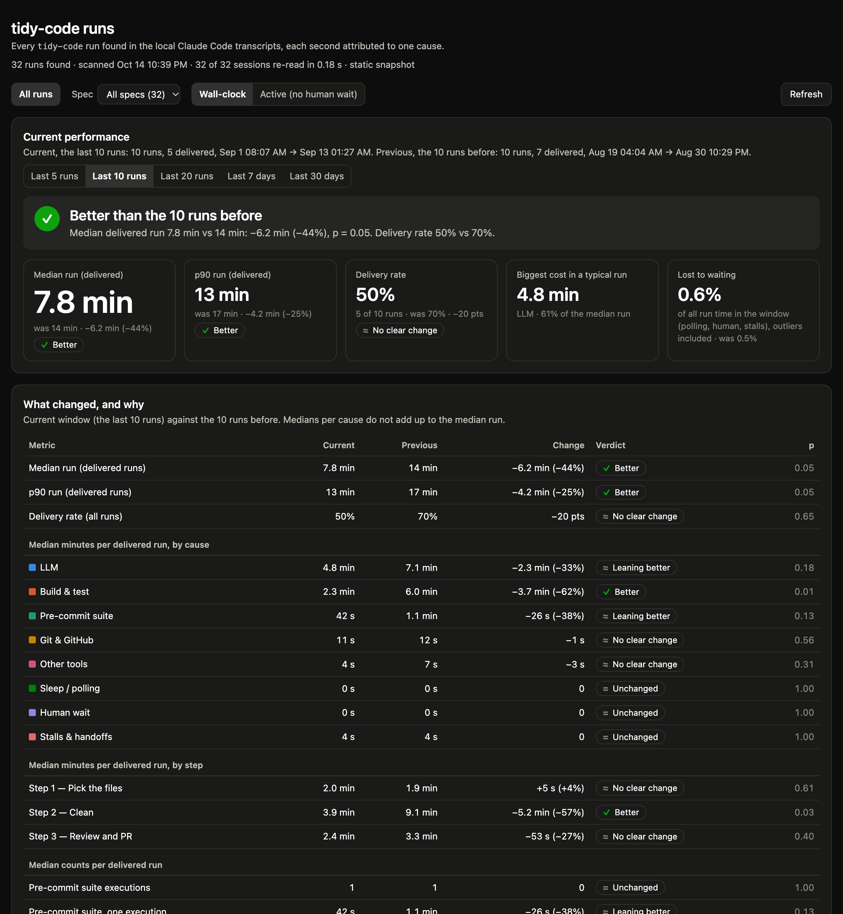

<div align="center">

# 🔭 create-observe-skill

### Measure your Claude Code skills. Know where every second goes.

[](https://github.com/Amirault/create-observe-skill/actions/workflows/ci.yml)
[](LICENSE)


</div>

A skill that writes skills. Name any of your Claude Code skills and it builds `observe-<skill>`, which
finds every past run in your local transcripts, attributes each second to one cause (LLM, tests,
hooks, git, subagents, human wait…) and tells you whether the skill got **better or worse** than before.



<sub>Fictional data from the demo in <a href="examples"><code>examples/</code></a>.</sub>

## Quickstart

Requires Claude Code and Python ≥ 3.9. Install the skill in the folder that holds the skill you want to observe:

```bash
git clone https://github.com/Amirault/create-observe-skill.git
create-observe-skill/install.sh ~/code/my-project     # or --user for ~/.claude/skills
```

Then, in Claude Code:

```text
/create-observe-skill tidy-code      # survey the runs, write observe-tidy-code/, check it
observe tidy-code                    # dashboard and verdict, any time after
```

Try it without transcripts of your own: `examples/check-demo.sh` builds the dashboard above from 32
fictional runs.

## How it works

- **Runs** start at `/<skill>` or a `Skill` call and end at the skill's report, with every subagent included.
- **Every second gets exactly one cause**, so the causes always add up to the run's duration.
- **Steps** are mapped from markers that only one step of your skill produces.
- **The verdict** compares the latest runs with the ones before using a permutation test, and calls it only at p < 0.05.

Everything runs locally and read-only. The profile (`config.json`) is written from evidence in your
transcripts; details are in [config.md](skills/create-observe-skill/references/config.md) and
[method.md](skills/create-observe-skill/references/method.md).

**Limits:** Claude Code transcripts only, and verdicts need a few runs per window.

## License

[MIT](LICENSE)
